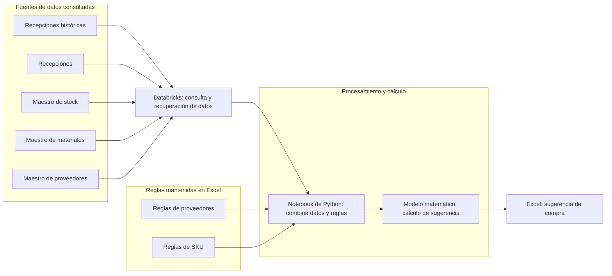

# Abastecimiento · Flujo actual

## Etapa 1: generación de orden de compra

El relevamiento actual alcanza la generación de una **sugerencia de compra en Excel**. Los pasos posteriores hasta la orden de compra todavía están pendientes de documentar.

El notebook de Python está conectado a Databricks para recuperar la información. El modelo matemático se representa como un paso lógico aplicado mediante el notebook, no como un sistema independiente. No se especifican el origen físico de las fuentes ni las fórmulas o el contenido de las reglas.

## Etapa 2: facturación en SAP

Pendiente de relevar y definir.

## Etapa 3: manejo de maestros

Pendiente de relevar y pulir; la propuesta deberá presentarse a gerencia.
