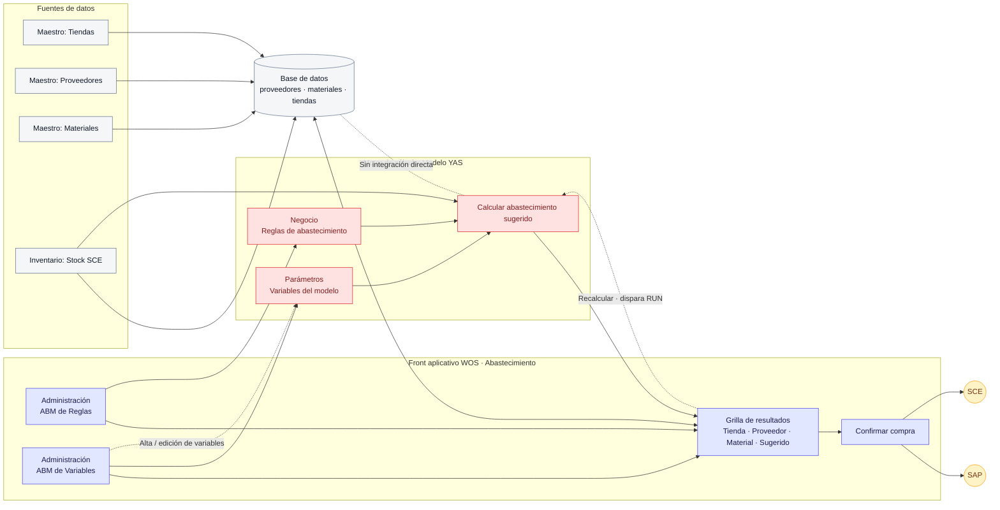

# Flujo de abastecimiento: WOS + Modelo YAS

Diagrama editable en Mermaid. GitHub lo renderiza en esta página; el archivo se mantiene privado junto con el repositorio.

## Consideraciones

- Las fuentes maestras y de stock alimentan la base de datos; el stock también alimenta el cálculo YAS.
- WOS administra reglas y variables, solicita recálculos y presenta sugerencias para confirmar.
- La confirmación de compra deriva los destinos SAP y SCE.
- La conexión directa Modelo YAS → Base de datos está indicada como no integrada en el diagrama de referencia.
- Validar interfaces y direcciones de flujo con el equipo técnico antes de usarlo como especificación de implementación.
