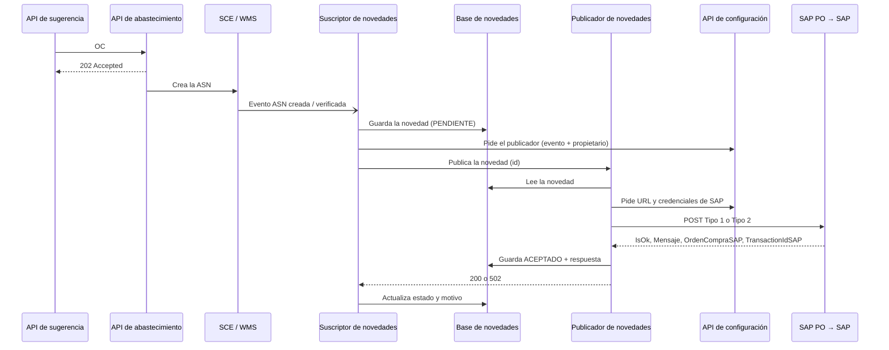
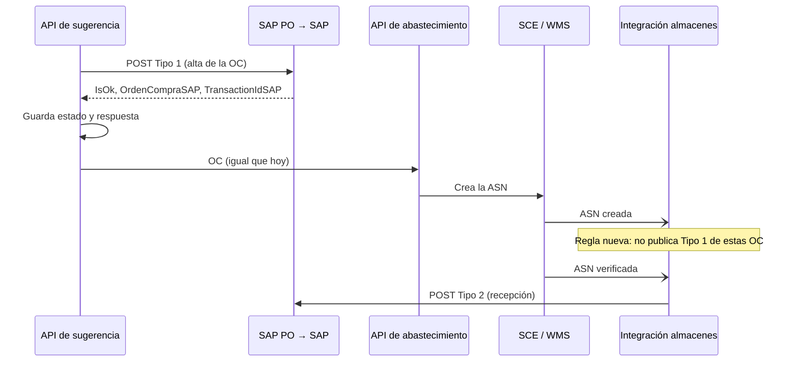

# Etapa 2 · Facturación en SAP

Cómo llega hoy la orden de compra (OC) a SAP y qué cambia si la API de sugerencia la envía directo. Documento público: no incluye URLs, credenciales ni datos de clientes; esos valores viven en la configuración y en los secretos de cada API.

## Flujo actual

`API de sugerencia → API de abastecimiento → SCE/WMS crea la ASN → evento de ASN → suscriptor → publicador → SAP PO → SAP`

| Evento de la ASN | Mensaje a SAP | Qué registra |
| --- | --- | --- |
| Creada | `Tipo = 1` | Alta de la OC |
| Verificada | `Tipo = 2` | Recepción de la mercadería |



### Qué hace el publicador

1. Lee la novedad que guardó el suscriptor.
2. Arma el mensaje (ver tabla). El `Tipo` sale del evento: creada = 1, verificada = 2.
3. Si la OC es nota de crédito (contrato con prefijo DV), la marca RECHAZADO y no la envía.
4. Si la novedad ya está ACEPTADO, devuelve la respuesta guardada sin reenviar.
5. Pide a la API de configuración la URL y las credenciales de SAP (hasta 3 intentos).
6. Envía el `POST` a SAP PO.
7. Si SAP no responde 2xx, corta y devuelve 502 con el mensaje de SAP.
8. Si responde 2xx, guarda ACEPTADO con `OrdenCompraSAP` y `TransactionIdSAP`. No valida `IsOk`: una respuesta con `IsOk = "FALSE"` también queda ACEPTADO.

## Mensaje a SAP

`POST` JSON con nombres en PascalCase, Basic auth y header `Cookie` opcional (ambos desde la configuración).

| Campo | Formato | Hoy (evento de ASN) | Propuesta (API de sugerencia) |
| --- | --- | --- | --- |
| `Tipo` | 1 car. | Creada `1` · verificada `2` | `1` |
| `Proveedor` | máx. 10 | `asnOriginalEcommerce` | Código SAP del proveedor (validar ceros) |
| `Pedido` | máx. 10 | `recepcionWh` (n° de OC en SCE) | A definir (ver puntos abiertos) |
| `ASN` | máx. 10 | `referenciaProveedor` | A definir |
| `Fecha` | `yyyy-MM-dd` | Fecha del evento | Fecha de la OC |
| `TransactionIdSAP` | opcional, máx. 10 | No se envía | El recibido, solo en reintentos |
| `Items[].Posicion` | entero | Dígitos de `lineaExterna` | N° de línea (1, 2, …) |
| `Items[].Cantidad` | texto `0.##` | `cantEsperada` (Tipo 1) · `cantRecibida` (Tipo 2) | Cantidad pedida (validar unidad) |
| `Items[].Material` | 18, ceros a la izquierda | `sku` | Código SAP del material |
| `Items[].Centro` | máx. 10 | `codigoCliente` | Centro SAP |
| `Items[].Almacen` | máx. 10 | `almacenConsumo` | Almacén SAP (validar código) |

Los ítems se agrupan por línea + material sumando cantidades. El Tipo 1 lleva todas las líneas; el Tipo 2, solo las recibidas (cantidad recibida > 0 y esperada = 0).

**Respuesta:** `IsOk` (`"TRUE"` / `"FALSE"`), `Codigo`, `Mensaje`, `OrdenCompraSAP` (n° de OC en SAP) y `TransactionIdSAP`. Con 400 o 401 devuelve `{ IsOk, Codigo, Mensaje }`.

Ejemplo con valores ficticios:

```json
{
  "Tipo": "1",
  "Proveedor": "123456",
  "Pedido": "1000001",
  "ASN": "A1000001",
  "Fecha": "2026-11-10",
  "Items": [
    { "Posicion": 1, "Cantidad": "12", "Material": "000000000000010000", "Centro": "C001", "Almacen": "A001" }
  ]
}
```

## Propuesta: envío directo desde la API de sugerencia

La API de sugerencia envía el Tipo 1 al generar la OC y guarda la respuesta. El envío a SCE/WMS no cambia: la recepción física (Tipo 2) sigue saliendo de almacenes, que debe dejar de publicar el Tipo 1 de estas OC.



### Checklist de implementación

- [ ] Cliente HTTP a SAP PO: `POST` JSON, Basic auth, `Cookie` opcional y timeout.
- [ ] Configuración en secretos: URL, usuario, contraseña, cookie y un flag para habilitar el envío.
- [ ] Mapper OC → mensaje Tipo 1 según la tabla.
- [ ] Éxito = 2xx **y** `IsOk = "TRUE"`; cualquier otro caso queda como error con `Codigo` y `Mensaje`.
- [ ] Guardar por OC: estado SAP, `OrdenCompraSAP`, `TransactionIdSAP`, mensaje y fecha.
- [ ] No reenviar OC aceptadas; en reintentos, mandar el `TransactionIdSAP` recibido.
- [ ] Reintento propio (endpoint o job): fuera del circuito de almacenes no hay reintento automático.
- [ ] Acordar con almacenes la regla anti-duplicado antes de habilitar.
- [ ] Tests: mapper, respuesta OK, `IsOk = "FALSE"`, 400/401 y timeout.

### Puntos abiertos

- **Pedido**: qué número enviar para que SAP vincule la recepción (Tipo 2), que hoy usa el n° de OC de SCE.
- **Duplicados**: cómo reconoce almacenes las OC que ya envió la API de sugerencia.
- **Cantidad**: la API envía bultos al WMS y el publicador no convierte por caja; confirmar si SAP espera bultos o unidades.
- **Proveedor y ASN**: formato del proveedor y qué valor va en `ASN` si todavía no existe en el WMS.
- **ASN rechazada en el WMS**: qué pasa con la OC ya creada en SAP.
- **Orden y fallas**: si se envía primero a SAP o al WMS y qué hacer si falla uno de los dos.
- **Accesos**: usuario técnico de SAP PO y acceso de red desde la API de sugerencia.
